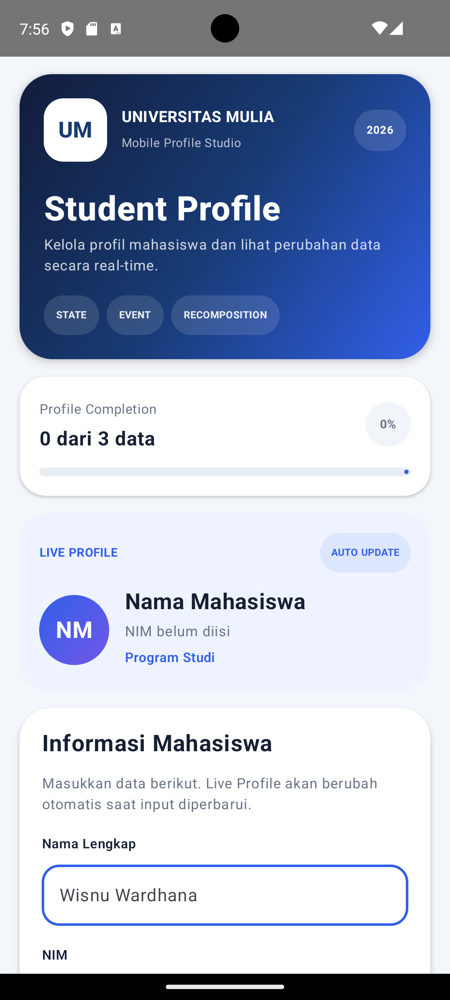
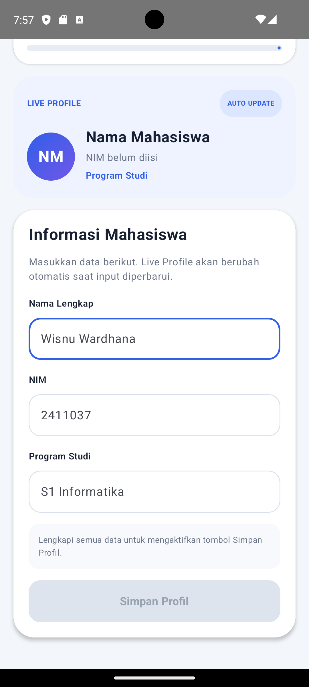
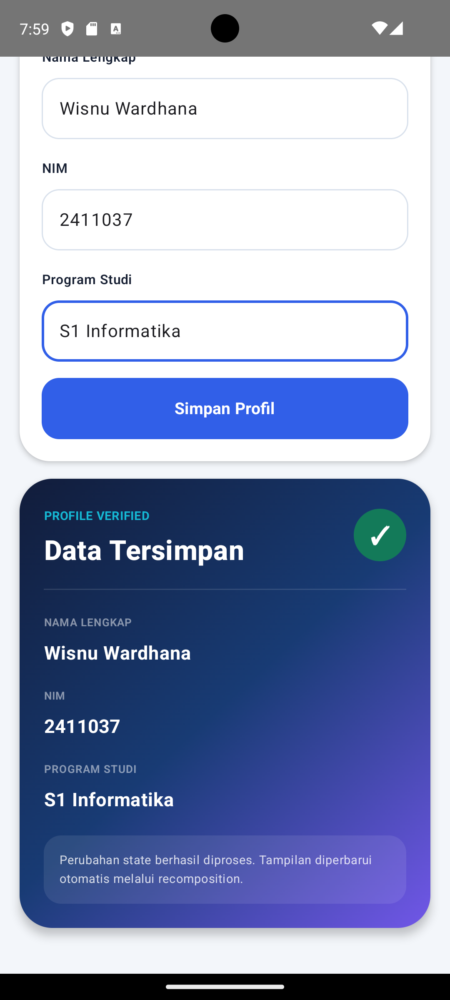

# Form Profil Mahasiswa

Aplikasi Android **Form Profil Mahasiswa** yang dibuat menggunakan **Kotlin** dan **Jetpack Compose** untuk menerapkan konsep **State, Event, dan Recomposition**.

## Identitas Mahasiswa

- Nama: Wisnu Wardhana
- NIM: 2411037
- Program Studi: S1 Informatika

## Deskripsi

Aplikasi ini digunakan untuk mengisi dan menampilkan profil mahasiswa secara interaktif.

Pengguna dapat memasukkan Nama Lengkap, NIM, dan Program Studi. Setiap perubahan input disimpan sebagai state dan langsung memengaruhi tampilan aplikasi.

Event seperti `onValueChange` dan `onClick` digunakan untuk mengubah state. Ketika state berubah, Jetpack Compose melakukan **recomposition** sehingga tampilan diperbarui secara otomatis tanpa mengubah UI secara manual.

## Fitur

- Input Nama Lengkap
- Input NIM
- Input Program Studi
- Validasi kelengkapan form
- NIM hanya menerima angka
- Progress kelengkapan profil
- Live Profile Preview
- Preview nama, NIM, dan program studi secara real-time
- Avatar otomatis berdasarkan inisial nama
- Tombol Simpan aktif setelah seluruh data terisi
- Menampilkan hasil profil setelah disimpan
- Tampilan berubah secara otomatis berdasarkan state
- Desain antarmuka modern menggunakan Material Design 3

## Konsep yang Digunakan

### 1. State

State digunakan untuk menyimpan data yang dapat berubah selama aplikasi berjalan.

Contoh:

```kotlin
var nama by remember {
    mutableStateOf("")
}

var nim by remember {
    mutableStateOf("")
}

var programStudi by remember {
    mutableStateOf("")
}
```

Nilai pada state digunakan oleh komponen UI.

Ketika nilai state berubah, Jetpack Compose akan memperbarui bagian tampilan yang menggunakan state tersebut.

### 2. Event

Event merupakan aksi pengguna yang menyebabkan perubahan pada state.

Contoh event ketika pengguna mengetik nama:

```kotlin
onValueChange = {
    nama = it
}
```

Contoh event ketika tombol Simpan Profil ditekan:

```kotlin
onClick = {
    savedNama = nama.trim()
    savedNim = nim.trim()
    savedProdi = programStudi.trim()

    sudahDisimpan = true
}
```

Event tidak menggambar ulang UI secara manual. Event hanya mengubah state.

### 3. Recomposition

Recomposition adalah proses Jetpack Compose memperbarui tampilan ketika state berubah.

Alur yang digunakan pada aplikasi:

```text
User Event
    ↓
Update State
    ↓
Recomposition
    ↓
UI Refresh
```

Contoh pada aplikasi:

```text
Pengguna mengetik Nama
        ↓
State nama berubah
        ↓
Jetpack Compose melakukan recomposition
        ↓
Live Profile Preview ikut berubah
```

Contoh lainnya:

```text
Pengguna menekan Simpan Profil
        ↓
sudahDisimpan = true
        ↓
State berubah
        ↓
Recomposition
        ↓
Card Data Tersimpan ditampilkan
```

## Implementasi State

State utama yang digunakan pada aplikasi:

```kotlin
var nama by remember {
    mutableStateOf("")
}

var nim by remember {
    mutableStateOf("")
}

var programStudi by remember {
    mutableStateOf("")
}

var sudahDisimpan by remember {
    mutableStateOf(false)
}
```

## Implementasi Event

Event input menggunakan `onValueChange`.

```kotlin
onValueChange = {
    nama = it
    sudahDisimpan = false
}
```

Event tombol menggunakan `onClick`.

```kotlin
onClick = {
    savedNama = nama.trim()
    savedNim = nim.trim()
    savedProdi = programStudi.trim()

    sudahDisimpan = true
}
```

## Validasi Form

Form dinyatakan valid apabila Nama, NIM, dan Program Studi sudah terisi.

```kotlin
val formValid =
    nama.isNotBlank() &&
            nim.isNotBlank() &&
            programStudi.isNotBlank()
```

Tombol Simpan Profil hanya aktif ketika `formValid` bernilai `true`.

## Progress Kelengkapan

Jumlah input yang sudah terisi dihitung menggunakan:

```kotlin
val jumlahTerisi = listOf(
    nama.isNotBlank(),
    nim.isNotBlank(),
    programStudi.isNotBlank()
).count { it }
```

Nilai progress:

```kotlin
val progress = jumlahTerisi / 3f
```

Progress akan berubah dari:

```text
0%
33%
66%
100%
```

sesuai jumlah data yang telah diisi.

## Live Profile Preview

Aplikasi memiliki Live Profile Preview yang memperlihatkan perubahan data secara langsung ketika pengguna mengetik.

Contohnya:

```text
Nama Lengkap diubah
        ↓
State nama berubah
        ↓
Live Profile Preview diperbarui
```

Fitur ini digunakan untuk memperlihatkan implementasi recomposition secara langsung.

## Data Pengujian

Data yang digunakan untuk pengujian aplikasi:

```text
Nama Lengkap : Wisnu Wardhana
NIM          : 2411037
Program Studi: S1 Informatika
```

## Teknologi

Project ini menggunakan:

- Kotlin
- Android Studio
- Jetpack Compose
- Material Design 3
- Android Emulator
- Pixel 7 API 34
- Git
- GitHub

## Struktur Project

```text
ProfilMahasiswa/
│
├── app/
│   └── src/
│       └── main/
│           ├── java/
│           │   └── com/
│           │       └── example/
│           │           └── profilmahasiswa/
│           │               └── MainActivity.kt
│           │
│           ├── res/
│           └── AndroidManifest.xml
│
├── screenshots/
│   ├── 01-sebelum-input.png
│   ├── 02-saat-input.png
│   └── 03-setelah-input.png
│
├── README.md
├── build.gradle.kts
├── gradle.properties
└── settings.gradle.kts
```

## Cara Menjalankan Aplikasi

1. Clone repository dari GitHub.
2. Buka folder project menggunakan Android Studio.
3. Tunggu proses Gradle Sync selesai.
4. Pilih emulator atau perangkat Android.
5. Jalankan aplikasi dengan tombol Run.
6. Isi Nama Lengkap.
7. Isi NIM.
8. Isi Program Studi.
9. Perhatikan perubahan pada Live Profile Preview.
10. Klik tombol Simpan Profil.
11. Data profil akan ditampilkan pada bagian hasil.

## Screenshot

### 1. Sebelum Input

Kondisi awal aplikasi ketika seluruh data masih kosong.



### 2. Saat Input Berubah

Tampilan ketika pengguna mulai mengisi data. Progress dan Live Profile Preview berubah berdasarkan state.



### 3. Setelah Disimpan

Tampilan setelah seluruh data terisi dan tombol Simpan Profil ditekan.



## Kesimpulan

Project Form Profil Mahasiswa berhasil menerapkan konsep **State, Event, dan Recomposition** menggunakan Jetpack Compose.

State digunakan untuk menyimpan data mahasiswa, event digunakan untuk memperbarui state berdasarkan interaksi pengguna, sedangkan recomposition digunakan oleh Jetpack Compose untuk memperbarui tampilan secara otomatis ketika state berubah.

Dengan mekanisme tersebut, aplikasi dapat menampilkan perubahan data secara real-time tanpa melakukan perubahan UI secara manual.

## Mata Kuliah

**Pemrograman Aplikasi Bergerak**

---

**Wisnu Wardhana**  
**2411037**  
**S1 Informatika**

## Hasil Pengujian

Pengujian dilakukan menggunakan Android Emulator Pixel 7 API 34.

Hasil pengujian menunjukkan bahwa:

- Progress berubah sesuai jumlah data yang diisi.
- Live Profile Preview diperbarui secara real-time.
- Tombol Simpan Profil aktif setelah seluruh field terisi.
- Data profil tampil setelah tombol Simpan Profil ditekan.
- Perubahan tampilan terjadi melalui mekanisme recomposition.